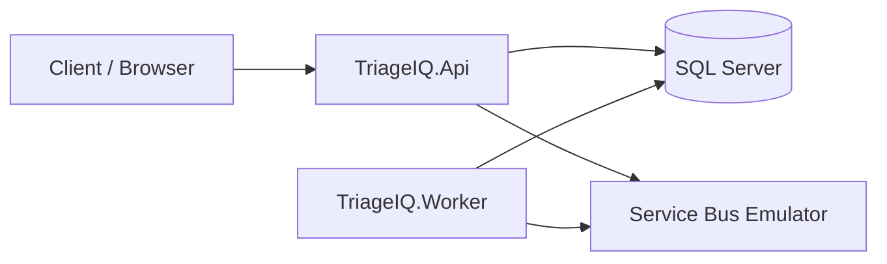

# TriageIQ

Event-driven AI ticket triage platform with guardrails, human review, and automated evaluation (.NET, Angular, Azure Service Bus, SQL Server, OpenTelemetry).

**Status:** Milestone M0 (foundation). Ticket ingestion, AI triage, and the Angular UI arrive in later milestones.

Full product specification: [docs/SPEC.md](docs/SPEC.md).

## Architecture (M0)



## Tech stack

- **Backend:** .NET 10 (LTS), ASP.NET Core Web API, layered projects (Domain → Application → Infrastructure)
- **Data:** SQL Server 2022 (Docker)
- **Messaging:** Azure Service Bus emulator (Docker), queue `tickets.incoming` in config
- **Tests:** xUnit, FluentAssertions, NSubstitute, WebApplicationFactory

## Prerequisites

- [.NET 10 SDK](https://dotnet.microsoft.com/download/dotnet/10.0)
- [Docker Desktop](https://www.docker.com/products/docker-desktop/) with Compose v2

## Quick start

```bash
cd C:\Users\rmalik\TriageIQ
copy .env.example .env
docker compose up --build
```

Verify health:

```bash
curl http://localhost:8080/health/live
curl http://localhost:8080/health/ready
```

When SQL Server and the Service Bus emulator are healthy, `/health/ready` returns HTTP 200.

## Run tests locally

```bash
dotnet test TriageIQ.slnx --configuration Release
```

Integration tests use the `Testing` environment and do not require Docker.

## Evaluation

The evaluation harness and dataset ship in **M6**. The `TriageIQ.Evals` project is a placeholder in M0.

## Repository hygiene

- Copy `.env.example` to `.env`; never commit secrets.
- Enable git hooks: `git config core.hooksPath .githooks` (see [CONTRIBUTING.md](CONTRIBUTING.md)).
- Study guide material (M9) lives only under ignored `study/` and `study-guides/` paths.

## License

MIT — see [LICENSE](LICENSE).