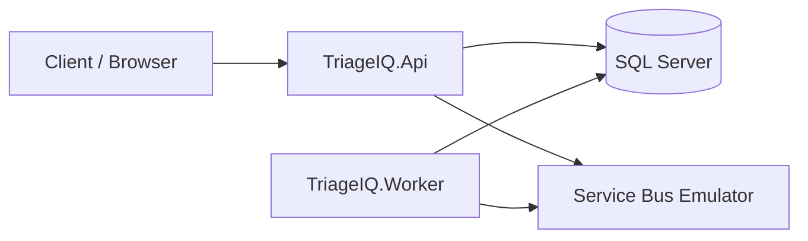

# TriageIQ

Event-driven AI ticket triage platform with guardrails, human review, and automated evaluation (.NET, Angular, Azure Service Bus, SQL Server, OpenTelemetry).

**Status:** Milestone M3 (LLM triage pipeline + analysis records). Cloud provider hardening and guardrails are M4+.

Full product specification: [docs/SPEC.md](docs/SPEC.md).  
**Step-by-step local run and Swagger testing:** [docs/LOCAL_SETUP.md](docs/LOCAL_SETUP.md).

## Architecture



## Tech stack

- **Backend:** .NET 10 (LTS), ASP.NET Core Web API, layered projects (Domain → Application → Infrastructure)
- **Data:** SQL Server 2022 (Docker), EF Core migrations
- **Messaging:** Azure Service Bus emulator (Docker), queue `tickets.incoming`
- **API docs:** Swagger UI in Development (`/swagger`), OpenAPI at `/openapi/v1.json`
- **Tests:** xUnit, FluentAssertions, WebApplicationFactory

---

## Complete setup (Docker) — quick checklist

| Step | Action |
|------|--------|
| 1 | Install **Docker Desktop** and start it |
| 2 | `cd C:\Users\rmalik\TriageIQ` |
| 3 | `copy .env.example .env` and set `JWT_SIGNING_KEY` (32+ chars) + seed admin vars |
| 4 | `docker compose up --build -d` |
| 5 | Browser: http://localhost:8080/health/ready → **Healthy** |
| 6 | Browser: http://localhost:8080/swagger → test register / login / tickets |
| 7 | (Optional) `dotnet test TriageIQ.slnx -c Release` |

Detailed instructions, JWT authorize flow, and reviewer ticket test: **[docs/LOCAL_SETUP.md](docs/LOCAL_SETUP.md)**.

---

## URLs at a glance (port 8080)

| What | URL | Notes |
|------|-----|--------|
| Swagger UI | http://localhost:8080/swagger | **Use this** for POST + JWT |
| Health live | http://localhost:8080/health/live | GET in browser OK |
| Health ready | http://localhost:8080/health/ready | GET in browser OK |
| OpenAPI JSON | http://localhost:8080/openapi/v1.json | Spec only |
| REST API | http://localhost:8080/api/... | Via Swagger or REST client |

Paste-only browser URLs **do not** work for `POST /api/auth/register` (you will see **405**). That is expected.

---

## Run tests

```bash
dotnet test TriageIQ.slnx --configuration Release
```

## Repository hygiene

- Copy `.env.example` to `.env`; never commit secrets.
- Enable git hooks: `git config core.hooksPath .githooks` (see [CONTRIBUTING.md](CONTRIBUTING.md)).

## License

MIT — see [LICENSE](LICENSE).